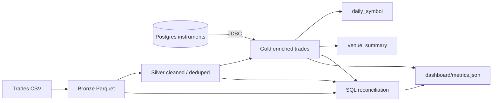

# PySpark Batch ETL Framework

I built this as a small, self-contained medallion batch pipeline for capital-markets style trade data. It takes a dirty CSV of trades, joins instrument reference data from Postgres over JDBC, cleans and dedupes in silver, applies business rules in gold, writes partitioned Parquet, runs SQL reconciliation across layers, and records a short Spark shuffle/AQE tuning comparison with real timings.

Live dashboard: https://rahul9121.github.io/pyspark-batch-etl/

## Architecture



## What each layer does

- **Bronze**: read the CSV as strings, stamp ingest metadata, land raw Parquet.
- **Silver**: normalize side codes, cast types, drop invalid rows, dedupe by `trade_id`.
- **Gold**: broadcast-join instruments from Postgres, enforce lot size and active flags, compute signed notional and trade buckets, write Parquet partitioned by `trade_date` and `venue`, plus aggregate tables.

## How to run (3 commands)

Needs Java 17+, Python 3.10+, Docker, and Make (or run the Python steps directly on Windows).

```bash
docker compose up -d
pip install -r requirements.txt && python scripts/fetch_jdbc.py
make run
```

Equivalent without Make:

```bash
python src/generate_data.py
python scripts/seed_postgres.py
python scripts/fetch_jdbc.py
# PowerShell: $env:SPARK_JARS = (Get-Content .spark_jars)
export SPARK_JARS=$(cat .spark_jars)
python src/run_pipeline.py
```

Tests:

```bash
make test
# or: python -m pytest -q
```

Open `dashboard/index.html` after a run (it reads `dashboard/metrics.json`).

## Design notes

- Synthetic generator seeds realistic dirt: duplicates, nulls, bad types, late timestamps. No downloads of market data, no API keys.
- Reference data lives in Postgres locally and as a service container in CI. Spark reads it with the PostgreSQL JDBC driver.
- The instruments dimension is small, so gold uses an explicit `broadcast` join.
- Gold trades are partitioned by `trade_date` and `venue` for prune-friendly reads.
- Reconciliation is plain Spark SQL comparing counts, key uniqueness, notional identity, and domain rules.
- Tuning compares default-heavy shuffle partitions without AQE against fewer partitions with AQE enabled, on the same aggregation, and writes both timings into the dashboard JSON.

## Results

Numbers come from the latest local or CI run and are written to `dashboard/metrics.json`. Typical shape on the seeded 8k-row batch:

- Bronze holds the raw CSV row count including injected duplicates.
- Silver is lower after invalid rows and `trade_id` dedupe.
- Gold is at or below silver after inactive/lot-size rules.
- Reconciliation checks are expected to pass end to end.
- Tuned shuffle settings are usually faster than the oversized baseline on this laptop-sized job; the dashboard shows the measured seconds.

## Project layout

```
config/pipeline.yaml     batch sizes, Postgres, tuning knobs
src/generate_data.py     synthetic CSV + instruments
src/etl/                 bronze, silver, gold, reconcile
src/run_pipeline.py      orchestrates run + metrics JSON
scripts/                 JDBC fetch, Postgres seed/wait
dashboard/               static HTML + metrics.json
tests/                   pytest coverage of core behavior
```

## Limitations

- Local Spark only (`local[*]`). No cluster manager, no Hive metastore.
- Data volume is deliberately small so the full path stays under a couple of minutes.
- JDBC fallback to CSV exists if Postgres is down; production code would fail closed instead.
- No Slowly Changing Dimensions, no late-arriving fact handling beyond a flag, no exactly-once sink.
- Dashboard is static JSON on GitHub Pages, not a live query engine.
- Windows users may prefer calling the Python entrypoints directly if `make` is unavailable.

## License

MIT
